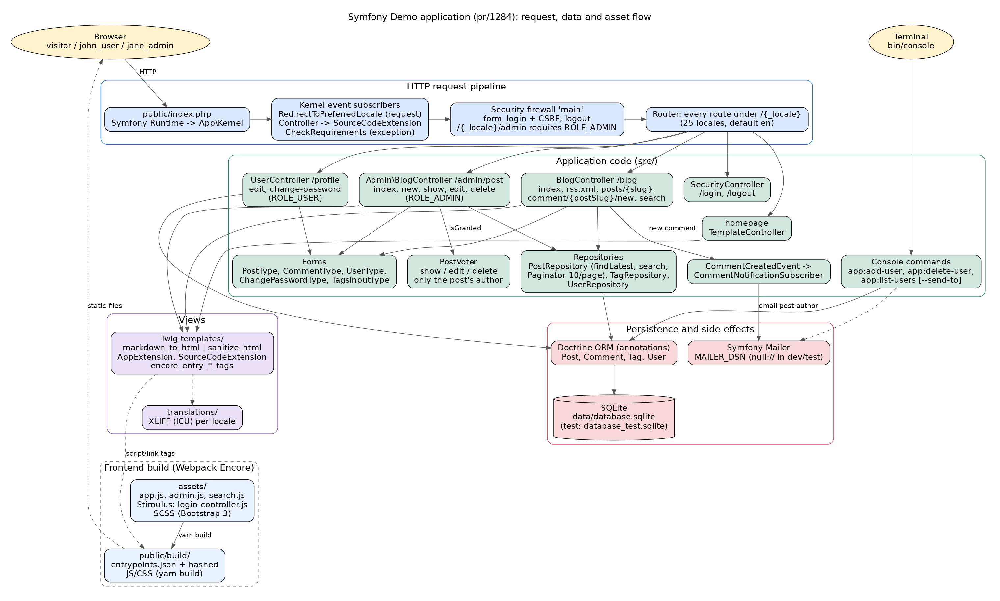

# Architecture

This document describes what the code on the `pr/1284` branch does today: a
server-rendered Symfony 6.0 blog (the Symfony Demo application) with a public
blog, a user profile area and an admin back office, backed by SQLite through
Doctrine ORM. There is no REST API: routes render Twig HTML, except the RSS
feed (`/blog/rss.xml`) and `blog_search`, which returns JSON results to the
instant search when called as an XMLHttpRequest.

The diagram source is [`diagrams/architecture.dot`](diagrams/architecture.dot)
(Graphviz). After editing it, run [`diagrams/render.sh`](diagrams/render.sh) to
regenerate `architecture.png` and `architecture.svg`.

## Request flow

1. **Front controller.** `public/index.php` loads `vendor/autoload_runtime.php`
   (Symfony Runtime), which boots `App\Kernel` with `APP_ENV`/`APP_DEBUG`
   from `.env`.
2. **Kernel event subscribers** (`src/EventSubscriber/`):
   - `RedirectToPreferredLocaleSubscriber` (`kernel.request`): on `/` only,
     redirects to `/{locale}` from the browser's `Accept-Language`, unless the
     referrer is the same host.
   - `ControllerSubscriber` (`kernel.controller`): hands the current
     controller to `SourceCodeExtension` so templates can show its source.
   - `CheckRequirementsSubscriber` (`kernel.exception`, `console.error`):
     turns a missing `pdo_sqlite` extension into a readable error.
3. **Security** (`config/packages/security.yaml`): one `main` firewall with
   `form_login` (CSRF on) and `logout`. Users come from the `User` entity by
   `username`; passwords use the `auto` hasher. `access_control` requires
   `ROLE_ADMIN` for `/{locale}/admin`; `ROLE_ADMIN` inherits `ROLE_USER`. The
   test environment adds `http_basic` so functional tests can log in.
4. **Routing**: `config/routes.yaml` maps `/{_locale}` to the homepage template
   (`TemplateController`); `config/routes/annotations.yaml` loads every
   controller's `#[Route]` attributes under the `/{_locale}` prefix. Locales
   are the 25 codes in the `app_locales` parameter (`config/services.yaml`),
   default `en`.

## Controllers

| Controller | Prefix | Routes | Access |
|---|---|---|---|
| `BlogController` | `/blog` | `blog_index`, `blog_index_paginated`, `blog_rss`, `blog_post`, `comment_new` (POST), `blog_search` | public; posting a comment needs `IS_AUTHENTICATED_FULLY` |
| `SecurityController` | | `security_login`, `security_logout` | public |
| `UserController` | `/profile` | `user_edit`, `user_change_password` | `ROLE_USER` |
| `Admin\BlogController` | `/admin/post` | `admin_index`/`admin_post_index`, `admin_post_new`, `admin_post_show`, `admin_post_edit`, `admin_post_delete` (POST, CSRF token) | `ROLE_ADMIN`; show/edit/delete also go through `PostVoter` |

`PostVoter` (`src/Security/PostVoter.php`) grants `show`, `edit` and `delete`
on a `Post` only to its author, so one admin cannot change another admin's
posts.

Entities in route parameters (`{slug}`, `{postSlug}`, `{id}`) are loaded by
`sensio/framework-extra-bundle` param converters.

## Domain and persistence

- **Entities** (`src/Entity/`, Doctrine annotations): `Post` (title, slug,
  summary, Markdown content, publishedAt, author, comments, tags), `Comment`
  (content, publishedAt, author, post), `Tag` (name), `User` (fullName,
  username, email, hashed password, roles). Tables are prefixed
  `symfony_demo_`.
- **Repositories** (`src/Repository/`): `PostRepository::findLatest()` returns
  posts published up to now, newest first, optionally filtered by tag, wrapped
  in `App\Pagination\Paginator` (10 per page). `findBySearchQuery()` does a
  `LIKE` search on post titles for `blog_search`. `TagRepository` and
  `UserRepository` are plain Doctrine repositories.
- **Database**: SQLite. `DATABASE_URL` points at the committed
  `data/database.sqlite` (dev) and `data/database_test.sqlite` (test, see
  `.env.test`). `src/DataFixtures/AppFixtures.php` can regenerate the sample
  data (`jane_admin`, `tom_admin`, `john_user`, posts, comments, tags) with
  `bin/console doctrine:fixtures:load`. The `migrations/` directory is empty.
- **Forms** (`src/Form/`): `PostType`, `CommentType`, `UserType`,
  `ChangePasswordType`, plus `TagsInputType` (comma-separated tags through
  `TagArrayToStringTransformer`) and `DateTimePickerType`.

## Side effects

- Creating a comment dispatches `CommentCreatedEvent`;
  `CommentNotificationSubscriber` emails the post's author through Symfony
  Mailer from `app.notifications.email_sender`.
- `app:list-users --send-to=<email>` emails the user list the same way.
- `MAILER_DSN` is unset in `.env`; dev and test force `null://null`, so no mail
  leaves the machine unless you configure a DSN.

## Views

- Twig templates in `templates/` extend `base.html.twig` (public) or
  `admin/layout.html.twig` (admin). Post and comment bodies render with
  `markdown_to_html|sanitize_html` (`twig/markdown-extra` +
  `tgalopin/html-sanitizer-bundle`).
- `App\Twig\AppExtension` exposes `locales()` for the language switcher;
  `App\Twig\SourceCodeExtension` renders the "Show code" panel with the
  controller and template source.
- UI strings live in `translations/` as ICU XLIFF files, one per locale.

## Frontend assets

Webpack Encore (`webpack.config.js`) builds three entries from `assets/` into
`public/build/`:

- `app` (`assets/app.js`): Bootstrap 3 SCSS and jQuery plugins, highlight.js,
  documentation links, and the Stimulus app (`assets/bootstrap.js`), which
  lazy-loads `assets/controllers/login-controller.js` (fills the demo
  credentials and toggles password visibility on the login page).
- `admin` (`assets/admin.js`): date-time picker and typeahead tag input.
- `search` (`assets/search.js`): instant search on the search page; it calls
  `blog_search` with `X-Requested-With: XMLHttpRequest` and renders the JSON
  results.

Templates include them with `encore_entry_link_tags()` /
`encore_entry_script_tags()`, which read `public/build/entrypoints.json`.

## Console commands

`bin/console app:add-user`, `app:delete-user` and `app:list-users`
(`src/Command/`) manage users directly through Doctrine and the password
hasher.

## Tests and CI

- `tests/` holds PHPUnit functional tests (controllers, commands) and unit
  tests (`Validator`, `TagArrayToStringTransformer`). `phpunit.xml.dist` runs
  them with the Symfony PHPUnit bridge (PHPUnit 9.5) and DAMA Doctrine Test
  Bundle, which wraps each test in a rolled-back transaction.
- `.github/workflows/tests.yaml` and `lint.yaml` run on pull requests and on
  pushes to `main` (not `pr/1284`): PHPUnit on PHP 8.0, PHP-CS-Fixer, YAML,
  Twig, XLIFF and container linters, Doctrine schema validation and PHPStan.
